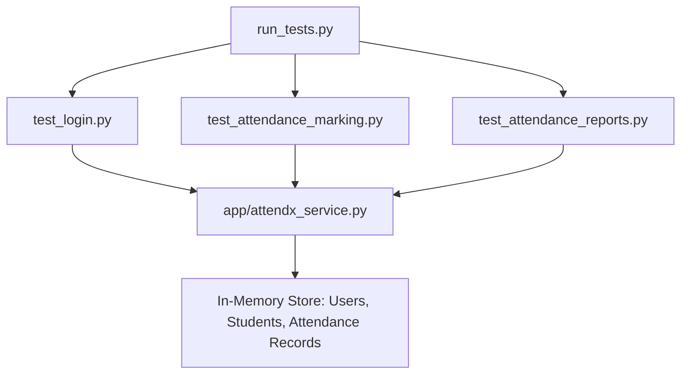

# AttendX — Student Attendance App Test Automation & Version Control


---

## 1. Project Background & Scenario

**AttendX** is a modular student attendance tracking application used by university faculty and students. 

### The Problem
Previously, the AttendX QA team (comprising three QA engineers) shared automated test scripts through informal, non-versioned mediums: **email attachments** and **USB pen drives**. This led to critical software engineering issues:
- **Overwritten Work**: One engineer frequently overwrote tests written by another.
- **Untracked Regressions**: Inability to identify when or why a test script broke.
- **Merge Conflicts**: No centralized system to merge concurrent changes to the test harness.
- **Zero Audit Trail**: No history of who changed which assertion, test scenario, or mock data.

### The Solution
Migrating all test suites, services, and execution runners into a centralized **Git & GitHub repository** (`AttendX-Test-Scripts` / `ST-AttendX`). This enables atomic commit histories, branch-based feature development, safe remote syncing (`git push` / `git pull`), and peer-reviewed pull requests.

---

## 2. Repository & Project Structure

```text
AttendX-Test-Scripts/
├── .gitignore                      # Ignore rules for pycache, virtual environments & IDEs
├── README.md                       # Comprehensive test automation & project documentation
├── run_tests.py                    # Unified CLI test runner with execution summary
├── GIT_WORKFLOW_WALKTHROUGH.md     # Step-by-step Git lab walkthrough & observation log
├── automate_git_helper.ps1         # PowerShell interactive helper script
├── app/
│   ├── __init__.py                 # Application package initializer
│   └── attendx_service.py          # Core AttendX business logic (Auth, Attendance, Analytics)
└── tests/
    ├── __init__.py                 # Test package initializer
    ├── test_login.py               # Test Suite 1: Authentication & Access Control (6 tests)
    ├── test_attendance_marking.py  # Test Suite 2: Daily Attendance Marking & Rules (7 tests)
    └── test_attendance_reports.py  # Test Suite 3: Attendance Analytics & Defaulters (2 tests)
```

---

## 3. Automation Test Suites & Specifications

The test automation harness is built using Python's robust `unittest` framework with zero external runtime dependencies, ensuring seamless execution across any lab machine.



### Suite 1: Login Functionality (`tests/test_login.py`)
Validates authentication rules, credential sanitization, session tokens, and role-based access control.

| Test ID | Test Function | Test Objective | Input Data | Expected Result | Status |
| :--- | :--- | :--- | :--- | :--- | :---: |
| **TC_AUTH_01** | `test_01_valid_student_login` | Verify student authentication | `username: student_01`, `pwd: Password123!` | Session token generated, `is_authenticated=True` | **PASS** |
| **TC_AUTH_02** | `test_02_valid_faculty_login` | Verify faculty authentication | `username: faculty_01`, `role: faculty` | Faculty session created with faculty name | **PASS** |
| **TC_AUTH_03** | `test_03_invalid_password` | Prevent access with incorrect password | `username: student_01`, `pwd: WrongPassword!` | Raises `AuthenticationError`: "Invalid username or password" | **PASS** |
| **TC_AUTH_04** | `test_04_nonexistent_user` | Handle unknown user credentials | `username: unknown_user_99` | Raises `AuthenticationError` | **PASS** |
| **TC_AUTH_05** | `test_05_empty_username_or_password` | Reject empty fields | `username: ""` or `pwd: ""` | Raises `AuthenticationError`: "Username and password are required" | **PASS** |
| **TC_AUTH_06** | `test_06_role_mismatch_prevention` | Prevent role spoofing (student claiming faculty) | `username: student_01`, `role: faculty` | Raises `AuthenticationError`: "User is not registered under role 'faculty'" | **PASS** |

---

### Suite 2: Attendance Marking (`tests/test_attendance_marking.py`)
Validates student attendance recording, format integrity, and duplicate prevention.

| Test ID | Test Function | Test Objective | Input Data | Expected Result | Status |
| :--- | :--- | :--- | :--- | :--- | :---: |
| **TC_ATT_01** | `test_01_mark_attendance_present_success` | Mark valid student 'Present' | `student_id: STU101`, `course: IT501`, `status: Present` | Record generated with unique `record_id` | **PASS** |
| **TC_ATT_02** | `test_02_mark_attendance_absent_success` | Mark valid student 'Absent' | `student_id: STU102`, `status: Absent` | Record created with status 'Absent' | **PASS** |
| **TC_ATT_03** | `test_03_prevent_duplicate_attendance_entry` | Prevent duplicate marking for same student/course/date | Mark twice for `STU101`, `IT501`, `2026-10-17` | Second call raises `AttendanceError`: "already marked" | **PASS** |
| **TC_ATT_04** | `test_04_invalid_student_id` | Reject non-existent student IDs | `student_id: STU999` | Raises `AttendanceError`: "Student ID does not exist" | **PASS** |
| **TC_ATT_05** | `test_05_invalid_course_code` | Reject unregistered course code | `course_code: INVALID999` | Raises `AttendanceError`: "Invalid course code" | **PASS** |
| **TC_ATT_06** | `test_06_invalid_date_format` | Reject invalid date formats | `date_str: 17-10-2026` (DD-MM-YYYY) | Raises `AttendanceError`: "Expected format: YYYY-MM-DD" | **PASS** |
| **TC_ATT_07** | `test_07_batch_attendance_marking` | Batch mark attendance for entire class | Array of 3 student entries (`STU101`, `STU102`, `STU103`) | `total_processed: 3`, `successful_count: 3`, `failed_count: 0` | **PASS** |

---

### Suite 3: Reports & Defaulter Analytics (`tests/test_attendance_reports.py`)
Validates attendance statistics, percentage calculations, and low-attendance thresholds.

| Test ID | Test Function | Test Objective | Input Data | Expected Result | Status |
| :--- | :--- | :--- | :--- | :--- | :---: |
| **TC_REP_01** | `test_01_calculate_attendance_percentage` | Calculate percentage based on total lectures | STU101: 3/4 lectures, STU102: 1/4 lectures | STU101 = `75.0%`, STU102 = `25.0%` | **PASS** |
| **TC_REP_02** | `test_02_detect_defaulter_students_below_75_percent` | Identify students with attendance < 75% | Threshold: `75.0%` | Returns `STU102` in defaulters list, excludes `STU101` | **PASS** |

---

## 4. Test Execution Guide

### Prerequisites
- Python 3.8 or higher installed on your system.

### Option 1: Run the Unified Test Runner (Recommended)
From the project folder, execute:
```bash
python run_tests.py
```

#### Sample Test Runner Console Output:
```text
======================================================================
 AttendX Student Attendance System - Automation Test Suite
 Target: QA Version Control Migration Project (23IT057)
======================================================================
test_01_mark_attendance_present_success (tests.test_attendance_marking.TestAttendanceMarking.test_01_mark_attendance_present_success) ... ok
test_02_mark_attendance_absent_success (tests.test_attendance_marking.TestAttendanceMarking.test_02_mark_attendance_absent_success) ... ok
test_03_prevent_duplicate_attendance_entry (tests.test_attendance_marking.TestAttendanceMarking.test_03_prevent_duplicate_attendance_entry) ... ok
test_04_invalid_student_id (tests.test_attendance_marking.TestAttendanceMarking.test_04_invalid_student_id) ... ok
test_05_invalid_course_code (tests.test_attendance_marking.TestAttendanceMarking.test_05_invalid_course_code) ... ok
test_06_invalid_date_format (tests.test_attendance_marking.TestAttendanceMarking.test_06_invalid_date_format) ... ok
test_07_batch_attendance_marking (tests.test_attendance_marking.TestAttendanceMarking.test_07_batch_attendance_marking) ... ok
test_01_calculate_attendance_percentage (tests.test_attendance_reports.TestAttendanceReports.test_01_calculate_attendance_percentage) ... ok
test_02_detect_defaulter_students_below_75_percent (tests.test_attendance_reports.TestAttendanceReports.test_02_detect_defaulter_students_below_75_percent) ... ok
test_01_valid_student_login (tests.test_login.TestLoginFunctionality.test_01_valid_student_login) ... ok
test_02_valid_faculty_login (tests.test_login.TestLoginFunctionality.test_02_valid_faculty_login) ... ok
test_03_invalid_password (tests.test_login.TestLoginFunctionality.test_03_invalid_password) ... ok
test_04_nonexistent_user (tests.test_login.TestLoginFunctionality.test_04_nonexistent_user) ... ok
test_05_empty_username_or_password (tests.test_login.TestLoginFunctionality.test_05_empty_username_or_password) ... ok
test_06_role_mismatch_prevention (tests.test_login.TestLoginFunctionality.test_06_role_mismatch_prevention) ... ok

----------------------------------------------------------------------
Ran 15 tests in 0.005s

OK
======================================================================
 Total Tests Run : 15
 Passed          : 15
 Failures        : 0
 Errors          : 0
======================================================================
>> ALL AUTOMATION TESTS PASSED SUCCESSFULLY! <<
```

### Option 2: Run Individual Test Suites
```bash
# Execute Login Tests
python tests/test_login.py

# Execute Attendance Marking Tests
python tests/test_attendance_marking.py

# Execute Analytics & Reports Tests
python tests/test_attendance_reports.py
```

---

## 5. QA Team Version Control Guidelines

To prevent the earlier issues of overwritten scripts and uncoordinated changes:

1. **Pull Before Starting Work**: Always execute `git pull origin main` to pull latest changes from team members.
2. **Branch per Feature**: Develop new test cases in dedicated branches (`git checkout -b feat/qr-code-test`).
3. **Atomic Commits**: Make small, cohesive commits with descriptive messages following Conventional Commits (`feat:`, `test:`, `fix:`, `docs:`).
4. **Code Reviews & Pull Requests**: Do not push directly to `main`; create a Pull Request on GitHub for peer review before merging.

---

## 6. Practical Lab Summary

- **Course**: Software Testing & Quality Assurance Lab
- **Student ID**: 23IT057
- **Repository**: [https://github.com/bhavy207/ST-AttendX](https://github.com/bhavy207/ST-AttendX)
- **Task Deliverable Document**: See `GIT_WORKFLOW_WALKTHROUGH.md` for the complete observation log and command history.
